# slabs_bot v0

A small differential-drive robot built to learn end-to-end ROS 2 control on real hardware. The stack runs inside a Dockerized Jazzy workspace and talks to an ESP32 over a framed serial protocol. `ros2_control`'s `diff_drive_controller` generates wheel velocities; a custom hardware interface converts them to RPM and streams them to the ESP32, which closes a PI loop around motor encoders.

An MPU6050 IMU is wired directly to the ESP32 and its accel + gyro data is sent inside every encoder report. On the ROS 2 side, `imu_filter_madgwick` and `robot_localization` fuse wheel odometry with gyro angular velocity to produce drift-corrected odometry and the `odom -> base_footprint` transform.

A 4-DOF MeArm manipulator is mounted on top of the base. It is driven by a separate Arduino Uno over the same framed serial protocol, exposed to `ros2_control` through the `mearm_hardware` plugin, and controlled by `joint_group_position_controller`.

[](https://www.youtube.com/watch?v=FEDQCEra-EA)

## Quick start

```bash
# 1. Build the container, remove the override compose file if not use the dev stage.
# Edit the compose file if not using an NVIDIA GPU.
docker compose build

# 2. Start it
docker compose up -d

# 3. Enter the workspace
docker compose exec ros2 bash

# 4. Build the ROS 2 workspace
colcon build --symlink-install

# 5. Launch the robot (controllers + IMU/EKF)
source install/setup.bash
ros2 launch my_robot_bringup my_robot.launch.py
```

`my_robot.launch.py` accepts two arguments:

- `use_esp32_hardware:=false` — use mock hardware for the diff drive instead of the ESP32.
- `use_mearm_mock_hardware:=true` — use mock hardware for the MeArm instead of the Arduino.

On a machine without the arm connected:

```bash
# Drive the arm in RViz with joint_state_publisher_gui (no hardware needed)
ros2 launch my_robot_description display_mearm.launch.py

# Test the arm controller against mock hardware
ros2 launch my_robot_bringup test_mearm_controller.launch.py
```

In a second terminal:

```bash
# Keyboard teleop (base + MeArm)
ros2 launch my_robot_bringup teleop_keyboard.launch.xml
#
#   Wheels:       u i o    Arm:
#                 j k l      w/x = shoulder up/down
#                 m , .      e/c = elbow up/down
#                            r/f = claw open/close
#                            a/d = arm base rotate
#                            s   = stop arm base
#                            h   = home pose
#                            [ ] = arm step size
#   k/space = stop wheels (space also stops the arm base)
#
# OR joystick teleop (base only)
ros2 launch my_robot_bringup teleop_joystick.launch.xml joy_dev:=/dev/input/js0
```

The keyboard teleop (`my_robot_teleop`) publishes `TwistStamped` to
`/diff_drive_controller/cmd_vel` and `Float64MultiArray` to
`/joint_group_position_controller/commands`, so it drives both the base and the arm.
It launches in an `xterm` window and also starts RViz. The joystick launch is
base-only and maps a standard Xbox layout (`LB` for turbo).

## Calibration workflow

1. **Measure ticks per revolution.** Use the `esp32_pid` project, spin the motor shaft manually
   and read encoder counts. The firmware uses `TICKS_PER_REVOLUTION = 1399.2`.
2. **Tune the PI loop.** `esp32_pid` runs a step-response test and prints good starting `Kp` and `Ki` values.
3. **Copy gains into firmware.** Paste `FF_DUTY_PER_RPM`, `PI_KP`, `PI_KI`, and `MIN_START_DUTY` into `esp32_firmware/src/main.cpp`.
4. **Upload firmware.** From `esp32_firmware/`, run `pio run -t upload`.
5. **Run the robot.** Launch the bringup and teleop packages.

## Hardware

### Pin map

| Function    | ESP32 GPIO | Notes                        |
| ----------- | ---------- | ---------------------------- |
| Left PWM    | 19         | LEDC channel 0               |
| Left DIR    | 18         |                              |
| Right PWM   | 26         | LEDC channel 1               |
| Right DIR   | 25         |                              |
| Left enc A  | 34         | Quadrature encoder           |
| Left enc B  | 35         |                              |
| Right enc A | 32         | Quadrature encoder           |
| Right enc B | 33         |                              |
| E-stop      | 4          | Active-low, internal pull-up |
| IMU SDA     | 21         | MPU6050 I2C data             |
| IMU SCL     | 22         | MPU6050 I2C clock            |
| IMU VCC     | 3V3        | Most breakout boards accept 3.3 V or 5 V |
| IMU GND     | GND        | Common ground                |

### Materials

- ESP32-Dev
- 4x DC motor with quadrature encoder (Same input for both motors on a single side, encoder from any one motor.)
- 2x motor driver (H-bridge, PWM + DIR input)
- Differential-drive chassis
- USB cable for flashing and serial
- MPU6050 breakout (GY-521 or similar)
- MeArm kit (4x micro servos)
- Arduino Uno (MeArm servo bridge)

## MeArm manipulator

A 4-DOF MeArm is mounted on the top cover of the base. An Arduino Uno drives the four
servos and talks to the ROS 2 host over the same framed binary protocol used by the
ESP32. On the ROS 2 side, `mearm_hardware` exposes the arm as a `ros2_control`
`SystemInterface`, and `joint_group_position_controller` sends target joint positions.

### Pin map (Arduino)

| Function       | Arduino pin           |
| -------------- | --------------------- |
| Base servo     | 6                     |
| Shoulder servo | 9                     |
| Elbow servo    | 10                    |
| Claw servo     | 11                    |
| Setup mode     | 2 (pull LOW to enter) |

### Joint conventions

All position joints use physical servo angles in radians, mapped to URDF joint
values by `scale`/`offset` parameters in `mearm.ros2_control.xacro`.

| Joint       | URDF range       | Meaning                                              |
| ----------- | ---------------- | ---------------------------------------------------- |
| `mearm_joint_0` | `-1.0 .. 1.0` | Continuous-rotation base speed (`-1` reverse, `0` stop, `+1` forward) |
| `mearm_joint_1` | `-1.57 .. 1.0` | Shoulder angle (`0` → servo 90°)                     |
| `mearm_joint_2` | `0.0 .. 1.57`   | Elbow angle (`0` → servo 90°)                        |
| `mearm_joint_3` | `0.0 .. 1.57`   | Claw (`0` closed at 80°, `1.57` open at 95°)         |

The arm has no encoders, so `read()` reports the last commanded position as state.
The base joint is continuous: its position state is integrated from the commanded speed.

### Setup mode

Pull Arduino pin 2 to ground and reset the board. All servos move to their physical
90° / stop position so the arm links and claw can be attached. Reset again with pin 2
floating to enter normal mode.

### Build and upload

```bash
cd mearm_arduino_firmware
pio run -t upload
pio device monitor
```

### Serial protocol

Packet type `0x10` (`ServoCmdPacket`) carries four little-endian floats:

```c
struct ServoCmd {
  float joint_0;  // base speed -1..+1
  float joint_1;  // shoulder physical servo angle (rad)
  float joint_2;  // elbow physical servo angle (rad)
  float joint_3;  // claw physical servo angle (rad)
};
```

A 500 ms watchdog stops the base if no valid frame arrives; the shoulder, elbow, and
claw hold their last commanded position. `NaN` commands are rejected in both the driver
and the firmware.

The hardware interface reads two parameters from the URDF:
`serial_port` (defaults to `/dev/ttyACM0`) and `baud_rate` (115200).

## Architecture

```mermaid
flowchart LR
    A[Joystick / Keyboard] -->|/joy| B[teleop_twist_joy]
    B -->|TwistStamped| C["/diff_drive_controller/cmd_vel"]
    C --> D[diff_drive_controller]
    D -->|wheel rad/s| E[esp32_hardware interface]
    E -->|VelocityCmd| F[ESP32]
    F -->|EncoderReport| E
    E -->|joint states| D
    F --> G[Motors + Encoders]
    E -->|sensor states| H[imu_sensor_broadcaster]
    H -->|/imu_sensor_broadcaster/imu| I[imu_filter_madgwick]
    I -->|/imu/data| J[robot_localization ekf_node]
    D -->|/diff_drive_controller/odom| J
    J -->|/odometry/filtered + odom->base_footprint| K[Navigation / RViz]
    A -->|Float64MultiArray| P[joint_group_position_controller]
    P -->|servo targets| M[mearm_hardware interface]
    M -->|ServoCmd| N[Arduino Uno]
    N -->|PWM| O[Arm servos]
```



1. **Teleop** (`my_robot_teleop/teleop_keyboard`) publishes `TwistStamped` for the base and `Float64MultiArray` for the arm; `teleop_twist_joy` publishes `TwistStamped` for the base only.
2. **diff_drive_controller** computes left/right wheel velocities in rad/s, publishes wheel odometry, and exposes joint states. `enable_odom_tf` is disabled because the EKF owns the `odom -> base_footprint` transform.
3. **esp32_hardware** is a `ros2_control` `SystemInterface` plugin. It reads commands, sends a binary `VelocityCmd` frame, parses `EncoderReport` frames, and exposes the `imu_sensor` state interfaces.
4. **ESP32 firmware** runs the PI controller at 100 Hz, reports encoders + IMU at 50 Hz, and monitors a command watchdog.
5. **imu_sensor_broadcaster** publishes raw accel + gyro from the hardware interface.
6. **imu_filter_madgwick** computes a 3D orientation estimate from accel + gyro.
7. **robot_localization** (`ekf_node`) fuses wheel linear velocity with IMU angular velocity and publishes `/odometry/filtered` plus the `odom -> base_footprint` TF.
8. **joint_group_position_controller** receives the four arm joint targets as `Float64MultiArray` and exposes them as position command interfaces.
9. **mearm_hardware** is a second `ros2_control` `SystemInterface` plugin. It maps URDF joint values to physical servo angles (`scale`/`offset`), clamps them to joint limits, and sends a `ServoCmd` frame.
10. **Arduino firmware** applies the servo commands over PWM, rejects `NaN`, and runs a 500 ms command watchdog that stops the base if the link drops.

## Engineering notes

### Why fuse wheel odometry with the IMU gyro instead of using the accelerometer?

A skid-steer / 4-wheel robot turns by slipping its wheels laterally. That slip makes wheel-odometry yaw rate unreliable, especially when spinning in place. The MPU6050 gyro measures the actual rotational rate of the chassis, so `robot_localization` uses it to correct heading.

The accelerometer is **not** used for position: double-integrating a low-cost MEMS accelerometer accumulates quadratic drift, and any small tilt projects gravity onto the horizontal axes. The accelerometer still serves a useful role inside `imu_filter_madgwick` as the gravity vector for roll/pitch, but the EKF only fuses angular velocity from the IMU.

### Startup gyro bias calibration

The MPU6050 has a small stationary offset (tens of LSB, i.e. a few tenths of a degree per second). `Esp32HardwareDriver` averages the first 50 IMU packets (~1 second) after `on_activate()` while the robot should be stationary, stores the mean as a bias, and subtracts it from every subsequent reading. This prevents slow yaw drift when the robot is stopped.

### ESP32 FreeRTOS task split

The firmware runs three tasks across the two ESP32 cores:

| Task           | Core | Priority | Rate   | Purpose                              |
| -------------- | ---- | -------- | ------ | ------------------------------------ |
| `control_task` | 1    | 3        | 100 Hz | PI motor control + encoder sampling  |
| `report_task`  | 1    | 2        | 50 Hz  | Pack and send EncoderReport + IMU    |
| `serial_task`  | 0    | 2        | 1 kHz  | Parse incoming VelocityCmd frames    |

Two FreeRTOS mutexes protect shared motor state and serial output.

### Why a custom binary protocol instead of text?

The original upstream project sent comma-separated strings. This repo uses a framed binary protocol, shared by the ESP32 base firmware and the Arduino MeArm firmware:

```
[0xAA][0x55][type u8][len u8][payload...][crc16 u16]
```

- Fixed-size structs map directly to C/C++ `struct` with `#pragma pack` and `static_assert` checks.
- CRC-16/CCITT-FALSE catches byte drops and bit errors on the USB-serial line.
- A state-machine parser resyncs on the next valid sync word after a bad frame, so one corrupt byte does not desync the stream.

### Watchdog

If the ESP32 receives no valid `VelocityCmd` for 500 ms, it zeros the target RPM, resets the integrator, and stops the motors. This protects against the PC crashing or the serial cable being unplugged.

### PI controller

The firmware runs two independent PI loops at 100 Hz. A feedforward term (`FF_DUTY_PER_RPM`) provides the bulk of the command, while the PI term corrects steady-state error. An integral limit prevents windup, and a minimum start duty overcomes static friction.

Measured RPM is computed from encoder delta ticks, the calibrated TPR, and the 10 ms control period.

### Command-interface NaN guard

`ros2_control` initializes command interfaces to `NaN` before a controller is loaded. The hardware interface now explicitly zeros them in `on_activate()` and checks for `NaN` in every `write()` call, so the motors cannot run unexpectedly while controllers are still spawning.

The ESP32 firmware also rejects `NaN` RPM commands as a second line of defense.

## Diagnostic tools

`esp32_firmware/tools/` contains two host-side utilities for hardware bring-up without starting the full ROS 2 stack:

- **`monitor`** — listens to the framed serial protocol and prints encoder ticks, timestamp, and raw IMU counts.
  ```bash
  cd esp32_firmware
  g++ -std=c++17 -O2 tools/monitor.cpp -o monitor
  ./monitor --port /dev/ttyUSB1
  ```
- **`serial_test`** — automated closed-loop test. It runs each motor forward/reverse, a spin, checks packet rate, and verifies RPM is within a tolerance.
  ```bash
  g++ -std=c++17 -O2 -pthread tools/serial_test.cpp -o serial_test
  ./serial_test --port /dev/ttyUSB1 --rpm 60 --secs 3 --tpr 1399.2
  ```

> Lift the wheels off the ground before running `serial_test`.

## Project structure

```text
.
├── Dockerfile                      # Jazzy base + dev container stages
├── docker-compose.yml              # Runtime container with device access
├── docker-compose.override.yml     # Dev stage with editors/debuggers
├── esp32_firmware/                 # Production base firmware (motors + IMU)
│   ├── include/protocol.h          # Shared binary protocol header
│   ├── src/main.cpp                # PI loop, serial framing, watchdog, IMU
│   └── tools/                      # Host-side diagnostic utilities
│       ├── monitor.cpp
│       └── serial_test.cpp
├── esp32_pid/                      # PID tuning helper firmware
├── mearm_arduino_firmware/         # Arduino firmware for the MeArm servos
│   ├── include/protocol.h          # Framed serial protocol header
│   ├── src/main.cpp                # Servo bridge, setup mode, watchdog
│   └── platformio.ini
├── src/
│   ├── esp32_hardware/             # ros2_control SystemInterface plugin
│   │   ├── include/esp32_hardware/
│   │   │   ├── esp32_hardware_interface.hpp
│   │   │   ├── esp32_hardware_driver.hpp
│   │   │   └── protocol.h
│   │   └── src/
│   │       ├── esp32_hardware_interface.cpp
│   │       └── esp32_hardware_driver.cpp
│   ├── mearm_hardware/             # ros2_control SystemInterface for the arm
│   │   ├── include/mearm_hardware/
│   │   │   ├── mearm_hardware_interface.hpp
│   │   │   ├── mearm_serial_driver.hpp
│   │   │   └── protocol.h
│   │   └── src/
│   │       ├── mearm_hardware_interface.cpp
│   │       └── mearm_serial_driver.cpp
│   ├── mearm_model/                # MeArm URDF, meshes and display launch
│   │   ├── launch/display.launch.py
│   │   ├── meshes/
│   │   ├── rviz/urdf.rviz
│   │   └── urdf/
│   ├── my_robot_bringup/           # Launch files and controller config
│   │   ├── config/
│   │   │   ├── my_robot_controllers.yaml
│   │   │   └── ekf.yaml            # robot_localization configuration
│   │   ├── launch/
│   │   │   ├── my_robot.launch.py
│   │   │   ├── my_robot.launch.xml
│   │   │   ├── teleop_keyboard.launch.xml
│   │   │   ├── teleop_joystick.launch.xml
│   │   │   └── test_mearm_controller.launch.py
│   ├── my_robot_description/       # Base + arm URDF / xacro
│   │   ├── launch/
│   │   ├── rviz/
│   │   └── urdf/
│   └── my_robot_teleop/            # Unified keyboard teleop (base + arm)
│       └── my_robot_teleop/teleop_keyboard.py
└── README.md                       # This file
```

## Credits

- ESP32 base firmware is a modified version of
  [pikkuri14/esp32diffrobot](https://github.com/pikkuri14/esp32diffrobot).
- The MeArm URDF and meshes in `src/mearm_model` come from
  [kubasikora/mearm_model](https://github.com/kubasikora/mearm_model) (MIT).

## License

Apache License
